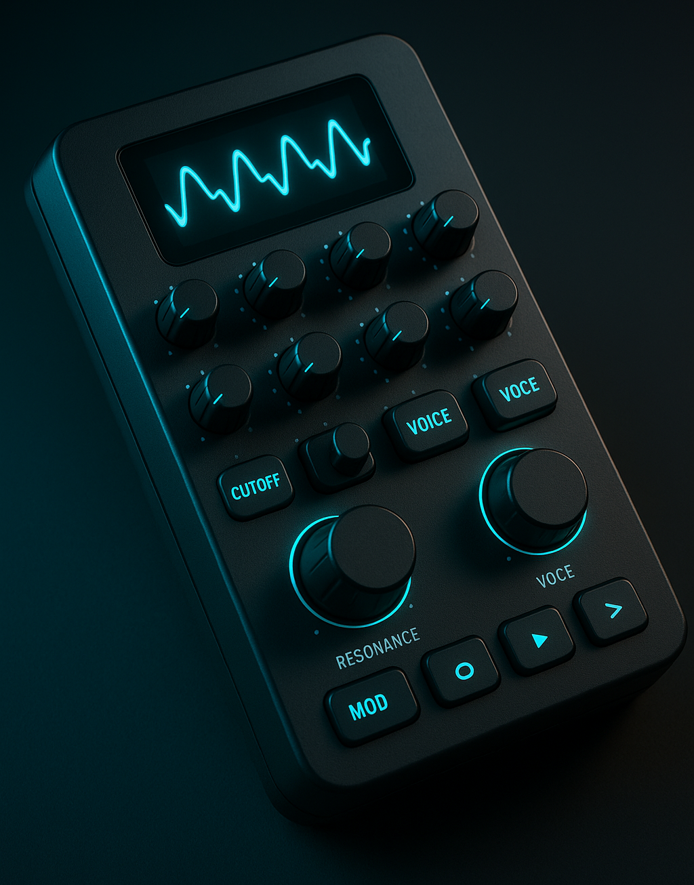

# ESP32-S3 Prototype Synthesizer

<p align="center">
  
</p>

**Breadboard experimentation platform** for discovering what makes a great pocket synthesizer. Build everything, test everything, keep only the best. The goal is a pocket-portable synth where every knob counts—this MVP helps us figure out which features are worth the space.

## Current Features (MVP Testing)

- **4-oscillator architecture** - Sine, Saw, Square, Sub with independent mixing and detuning
- **Moog ladder filter** - 4-pole lowpass with self-oscillating resonance
- **Professional audio quality** - 16-bit @ 44.1kHz with clean signal path
- **Dual-core architecture** - Core 0 for audio (PRO_CPU), Core 1 for control (APP_CPU)
- **High-precision ADC** - ADS1115 modules, 16-bit resolution, multisampled
- **Extensible control** - Modular pot architecture for testing up to 20+ parameters

## Quick Start

```bash
# Build firmware
./scripts/build.sh

# Run on device
./scripts/run.sh
```

## Documentation

- **[BUILD_PLAN.md](docs/mvp/BUILD_PLAN.md)** - Active MVP roadmap (breadboard/perfboard phases)
- **[Post-MVP Design](docs/post-mvp/DESIGN.md)** - Full 22-pot pocket-portable reference spec
- **[Hardware List](docs/post-mvp/HARDWARE.md)** - Complete component BOM and assembly notes

## Development

- **Platform**: ESP32-S3 (dual-core Xtensa LX7 @ 240 MHz)
- **Language**: Rust (esp-hal 1.0.0-rc.0)
- **Audio**: PCM5102A DAC via I2S
- **Display**: SSD1351 1.5" OLED (128×128 RGB, SPI)
- **Controls**: ADS1115 16-bit ADCs (dual I2C buses)

## Philosophy

**Prototype-driven design**: Build features on breadboard, play with them extensively, measure their musical value. Only the most inspiring and fun features will make it to the final pocket synth. Every pot needs to earn its space.

**Engineering values**: Full parameter control, no hidden behavior, precise and predictable DSP. Professional audio quality even during prototyping—if it sounds good here, it'll sound great in the final device.

---

Built with Rust 🦀 on ESP32-S3
